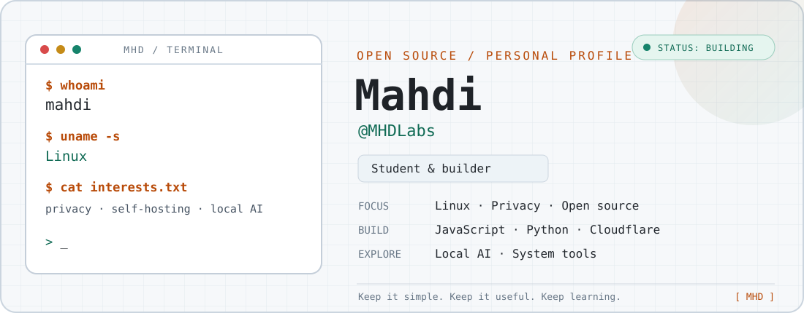

  <picture>
    <source media="(prefers-color-scheme: dark)" srcset="assets/header-dark.svg">
    <source media="(prefers-color-scheme: light)" srcset="assets/header-light.svg">
    
  </picture>

  <a href="https://github.com/MHDLabs">
    <picture><source media="(prefers-color-scheme: dark)" srcset="assets/button-github-dark.svg"></picture>
  </a>
  <a href="https://github.com/MHDLabs?tab=repositories">
    <picture><source media="(prefers-color-scheme: dark)" srcset="assets/button-projects-dark.svg"></picture>
  </a>
  <a href="https://mhdlabs.github.io/under-the-noise-rain/">
    <picture><source media="(prefers-color-scheme: dark)" srcset="assets/button-story-dark.svg"></picture>
  </a>

## `$ whoami`

Hey! I'm **Mahdi** — a student, Linux enthusiast, and open-source builder.

I learn by making things: small tools, self-hosted services, experiments with AI, and projects that solve real problems. I enjoy exploring how systems work, keeping software lightweight, and having control over the tools I use.

- 🐧 **Systems:** Linux, especially Arch and Debian-based environments
- 🔐 **Interests:** Privacy, self-hosting, open-source software, and system-level tools
- ☁️ **Building with:** Cloudflare Workers, D1, KV, and Durable Objects
- 🤖 **Exploring:** Local AI, LLMs, and agent-based workflows
- 🧪 **Languages I use:** JavaScript and Python

## `./selected-projects`

| Project | What it does |
| --- | --- |
| [⚡ Nyra](https://github.com/MHDLabs/Nyra) | A self-hosted AI assistant for Telegram, running on Cloudflare Workers. |
| [📬 TempMail-CFW](https://github.com/MHDLabs/TempMail-CFW) | A lightweight temporary email service built with Cloudflare Workers and D1. |
| [🛰️ TWP-CF](https://github.com/MHDLabs/TWP-CF) | A Telegram MTProto web proxy powered by Cloudflare Workers. |
| [🧰 BPB-Worker-Panel](https://github.com/MHDLabs/BPB-Worker-Panel) | A configurable Cloudflare-based panel for proxy tools and network utilities. |
| [🐍 Terminal-Snake](https://github.com/MHDLabs/Terminal-Snake) | A lightweight terminal Snake game written in Python, with local-only score records. |
| [🌧️ Under the Noise Rain](https://github.com/MHDLabs/under-the-noise-rain) | A Persian post-apocalyptic story with an offline-first web reader and Android build. |

## `toolbox`

  
  
  
  
  
  

## `currently_exploring`

- Making local AI workflows useful on modest hardware.
- Building small, privacy-conscious tools.
- Learning more about Linux internals and systems programming.

---

  <i>“Keep it simple. Keep it useful. Keep learning.”</i> 
  Built with curiosity, a terminal, and way too many tabs open. <code>█</code>

